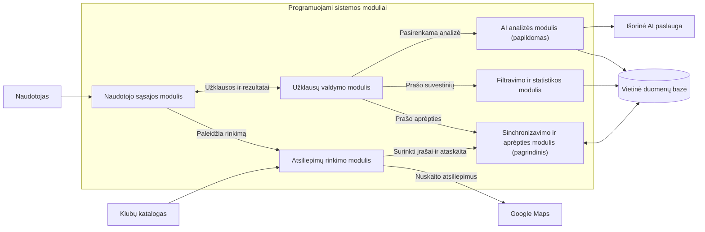

# Lietuvos sporto klubų atsiliepimų rinkimo ir analizės sistema
Kursinio darbo I dalis: projektavimo dokumentas

## 1. Problema ir idėja

**Sistema vienu sakiniu:** Vietinė sistema surenka pagrindinių Lietuvos sporto klubų atsiliepimus iš Google Maps, saugo juos, parodo duomenų aprėptį ir leidžia lyginti klubų vertinimus bei komentarus.

**Problema ir dabartinis procesas:** Norint palyginti kelių tinklų ir klubų klientų patirtį, reikia atskirai atidaryti jų Google Maps puslapius, skaityti atsiliepimus ir rankiniu būdu skaičiuoti įvertinimus. Pakartotinai tikrinant klubus sunku atskirti naujus įrašus nuo jau matytų ir įvertinti, ar surinkti visi matomi atsiliepimai.

**Nauda:** Naudotojas vienoje vietoje matys atsiliepimus, jų pokyčius, savininko atsakymus ir kiekvieno klubo surinkimo būseną. Programa pateiks duomenų analizę, kuri bus grindžiama išsaugotais įrašais, o nežinomi ar nepilni duomenys bus aiškiai pažymėti.

**Naudotojai:** Sporto klubų rinką analizuojantis asmuo arba klubų vadybininkas paleidžia rinkimą, tikrina duomenis, filtruoja bei lygina klubus ir eksportuoja rezultatus.

**Prielaidos:** Lyginimui pakanka viešai matomų Google Maps atsiliepimų, tačiau jų skaičius ir tekstas gali keistis. Google Maps rodomas bendras atsiliepimų skaičius laikomas orientyru, o ne garantija, kad visas istorinis turinys pasiekiamas. Santykinės datos, pavyzdžiui, „prieš 2 savaites“, yra apytikslės.

## 2. Apimtis

| Funkcija | Ką naudotojas galės atlikti | Vaidmuo |
| --- | --- | --- |
| Klubų atsiliepimų rinkimas | Pasirinkti vieną klubą arba visus veikiančius klubus, paleisti rinkimą ir pakartotinį patikrinimą | Pagalbinė įvestis pagrindiniam moduliui |
| Atsiliepimų sinchronizavimas ir aprėpties vertinimas | Įkelti surinktus įrašus, išvengti dublikatų, išsaugoti pilną tekstą ir matyti, ar klubo aprėptis patvirtinta | **Pagrindinis modulis** |
| Filtravimas ir palyginimas | Atrinkti atsiliepimus pagal klubą, laikotarpį, žvaigždutes, komentarą ir atsakymą; peržiūrėti suvestines bei tendencijas | Pagalbinė funkcija |
| Eksportas | Išsaugoti filtruotus atsiliepimus arba palyginimo duomenis CSV formatu | Pagalbinė funkcija |
| Pasirenkama DI analizė | Pagal aiškų naudotojo veiksmą apibendrinti atrinktus rašytinius komentarus | Papildoma funkcija |

**Į kursinio darbo apimtį neįeina:** Naudotojų paskyros, debesijos (angl. “cloud”) serveris, kad bus pasiektas visas Google Maps atsiliepimų istorinis archyvas. DI santraukos nėra būtinos pagrindinio modulio veikimui.

## 3. Pagrindinis modulis

**Pavadinimas ir atsakomybė:** Atsiliepimų sinchronizavimo ir aprėpties vertinimo modulis. Jis patikrina surinktų įrašų tinkamumą, sujungia juos su vietiniu archyvu ir nustato klubo duomenų būseną.

**Logika, kurią reikės projektuoti ir testuoti:** Įrašų validavimas, tapatybės nustatymas pagal klubo ir atsiliepimo ID, pilno teksto išsaugojimas konflikto metu, aprėpties klasifikavimas pagal archyvo kiekį, Maps rodomą kiekį, klaidas ir sutrumpintą tekstą.

**Įvestis:** Klubo ID, CSV įrašai su `review_id`, `rating`, `published_at`, `text` ir papildomais laukais; ankstesnis SQLite archyvas; rinkimo ataskaita su `displayed_review_count`, `last_error` ir patikrinimo laiku. Pavyzdžiui, klubui `gym-vilnius-mokslininku-g-6a` pateikiami du įrašai `r1` ir `r2`, o Maps rodo 2 atsiliepimus.

**Išvestis:** Atnaujinti unikalūs įrašai SQLite bazėje ir klubo būsena. Pavyzdyje bazėje lieka 2 įrašai; jei nėra klaidos ar sutrumpinto teksto, būsena yra `complete`. Jei Maps skaičius nežinomas, būsena yra `unverified`, net jei įrašų yra.

**Veikimo eiga:**
1. Rinktuvas pagal klubų katalogą suranda atitinkamą Maps vietą, išskleidžia matomus komentarus ir suformuoja CSV bei rinkimo ataskaitą. Dviprasmišką vietos atitikmenį turi patvirtinti žmogus.
2. Importo dalis patikrina klubo ID, 1–5 žvaigždučių įvertinimą, datą ir kitus privalomus laukus. Neteisinga eilutė grąžina klaidą su jos numeriu.
3. Įrašai įrašomi į SQLite pagal porą `(club_id, review_id)`. Sutampantis ID atnaujina esamą įrašą, o sutrumpintas naujas tekstas neturi pakeisti anksčiau išsaugoto pilno teksto.
4. Aprėptis apskaičiuojama iš išsaugotų įrašų ir rinkimo ataskaitos. Sąsaja rodo būseną bei trūkstamų įrašų skaičių tik tada, kai Maps bendras skaičius žinomas.

### Taisyklės arba sprendimo žingsniai
1. Įrašas priimamas tik tada, kai `club_id` yra kataloge, `rating` yra sveikas skaičius nuo 1 iki 5, o data yra tinkamo ISO formato. Klaidingo CSV importas atmetamas prieš įrašymą į bazę.
2. Vieną atsiliepimą identifikuoja `(club_id, review_id)`. Pakartotinis to paties CSV importas nedidina unikalių įrašų skaičiaus. Jei ID nepateiktas, jis sudaromas iš klubo, datos, įvertinimo, autoriaus ir teksto; tai silpnesnė tapatybė, nes pakeistas tekstas gali sukurti naują ID.
3. Jei naujai gautas komentaras ar savininko atsakymas baigiasi „… More“, anksčiau išsaugotas pilnas tekstas išlaikomas. Jei archyve vis tiek lieka sutrumpintas tekstas, klubą reikia rinkti pakartotinai.
4. `complete` būsena suteikiama tik žinant Maps rodomą skaičių, turint bent tiek unikalių įrašų, neturint paskutinės rinkimo klaidos ir išsaugotų sutrumpintų tekstų. Kai Maps skaičius nežinomas, būsena yra `unverified`, o trūkstamas kiekis neskaičiuojamas.

### Scenarijai būsimiems testams

| Scenarijus | Pradinės sąlygos ir konkreti įvestis | Veiksmas | Tikslus laukiamas rezultatas |
| --- | --- | --- | --- |
| Įprastas atvejis | Archyve yra klubo `gym-vilnius-mokslininku-g-6a` įrašas `r1`; CSV turi `r1` ir naują `r2`, abu su leistinais įvertinimais ir datomis; Maps rodo 2; klaidos ir sutrumpinto teksto nėra | Importuoti CSV ir apskaičiuoti aprėptį | Archyve yra 2 unikalūs įrašai, `missing = 0`, būsena `complete`; antras tokio paties CSV importas skaičiaus nekeičia |
| Ribinis atvejis | Archyve yra 1 pilnas komentaras su ID `r1`; naujame CSV tas pats ID turi tekstą `Short … More`; Maps bendras skaičius nežinomas | Importuoti CSV ir apskaičiuoti aprėptį | Archyve lieka 1 įrašas su ankstesniu pilnu tekstu; `missing = null`, būsena `unverified` |
| Klaida | Archyve yra 1 įrašas; CSV antraštės teisingos, bet 2 eilutės `rating = 6` | Importuoti CSV | Grąžinama klaida, nurodanti 2 eilutę; archyve lieka 1 ankstesnis įrašas, naujų neįrašoma |

**Jei modulis naudoja AI:** Netaikoma. AI santraukos yra atskira papildoma funkcija ir nekeičia sinchronizavimo ar aprėpties sprendimo.

## 4. Kokybės atributas

**Pasirinktas atributas:** Duomenų vientisumas.

**Kodėl svarbus šiai sistemai:** Pasikartojantys arba prarasti atsiliepimai iškraipytų vidurkius bei tendencijas. Klaidingai pažymėta pilna aprėptis sukurtų nepagrįstą pasitikėjimą palyginimu.

**Tikrinimo scenarijus ir sąlygos:** Vietinėje testų bazėje importuoti 100 žinomų ID, tą patį rinkinį pakartoti, tada pateikti 10 tų pačių ID su sutrumpintais tekstais ir vieną CSV su neteisingu įvertinimu. Atskirai patikrinti aprėptį, kai Maps kiekis yra 100, nežinomas arba užregistruota klaida.

**Sėkmės kriterijus:** Po pakartotinių importų lieka tiksliai 100 unikalių įrašų ir nė vienas pilnas komentaras nėra pakeistas sutrumpintu. Klaidingas failas neprideda nė vieno įrašo. Kai Maps rodo 100, nėra klaidos ir archyve nelieka sutrumpintų tekstų, grąžinama `complete`; nežinomas skaičius grąžina `unverified`, o registruota klaida - `error`.

**Numatytas projektavimo sprendimas:** Unikalus sudėtinis raktas SQLite bazėje, importo validavimas prieš įrašymą, konfliktų sprendimo taisyklė pilnam tekstui išsaugoti ir aiškios aprėpties būsenos.

**Kaip patikrinsiu vėlesniame etape:** Paleisiu automatinius Node.js ir Python testus su fiksuotais CSV bei rinkimo ataskaitos duomenimis; palyginsiu bazės eilutes ir aprėpties API atsakymus su laukiamais rezultatais. Šie skaičiai yra tikslas, o ne jau atlikto bandymo rezultatai.

**Sprendimo kaina arba ribojimas:** Reikia saugoti stabilius ID, validuoti duomenis ir palaikyti importo taisykles. Fallback ID iš turinio gali neatpažinti pataisyto komentaro kaip to paties atsiliepimo. Maps bendras skaičius pats savaime neįrodo istorinio rinkinio pilnumo.

## 5. Pradinė sistemos struktūra

### Paprasta schema

Programuojami moduliai sugrupuoti schemos rėmelyje. Klubų katalogas ir duomenų bazė yra sistemos duomenys, o Google Maps ir AI paslauga - išoriniai šaltiniai. Pagrindinė logika veiks sinchronizavimo ir aprėpties modulyje.

| Sistemos dalis | Atsakomybė |
| --- | --- |
| Naudotojo sąsajos modulis | Leis pasirinkti klubus ir rinkimo veiksmus, rodyti aprėptį, atsiliepimus ir suvestines |
| Atsiliepimų rinkimo modulis | Pagal klubų katalogą suras vietą, nuskaitys matomus atsiliepimus ir parengs įrašus bei rinkimo ataskaitą |
| Užklausų valdymo modulis | Priims sąsajos užklausas ir perduos jas tinkamam duomenų apdorojimo moduliui |
| Sinchronizavimo ir aprėpties modulis - pagrindinis | Patikrins įrašus, išvengs dublikatų, išsaugos pilną tekstą ir nustatys klubo aprėpties būseną |
| Filtravimo ir statistikos modulis | Filtruos atsiliepimus ir skaičiuos klubų bei laikotarpių palyginimus |
| AI analizės modulis - papildomas | Naudotojui paprašius parengs komentarų atranką ir kreipsis į išorinę AI paslaugą |
| Klubų katalogas ir vietinė duomenų bazė | Saugos klubų aprašus, atsiliepimus ir rinkimo būseną |

**Planuojamos technologijos ir pasirinkimo priežastys:** Rinkimui planuoju naudoti JavaScript ir Playwright, nes reikės valdyti naršyklės sąsają. Vietiniam duomenų apdorojimui ir saugojimui rinksiuosi Python ir SQLite, kad prototipui nereikėtų atskiro debesijos serverio. Naudotojo sąsają kursiu su HTML, CSS ir JavaScript, o darbalaukio programai naudosiu Electron.

## 6. AI panaudojimas

### AI rengiant šį dokumentą

| Priemonė ir užduotis | Ką panaudojau | Ką atmečiau arba perrašiau ir kodėl | Kaip patikrinau |
| --- | --- | --- | --- |
| Codex: parengti I etapo projektavimo dokumento juodraštį | Dokumento struktūrą, modulių aprašymų ir testų scenarijų pradinius variantus | Patikslinau rinktuvo, AI funkcijos ir projekto paskirties aprašymus, kad jie atitiktų numatytą sistemos veikimą | Asmeniškai perskaičiau ir redagavau tekstą. |
| Codex: sugeneruoti pradinę sistemos modulių schemą | Mermaid schemos pagrindą ir modulių ryšius | Perdariau schemą, kad joje būtų aiškiai matomi programuojami loginiai moduliai, o ne programos failų pavadinimai | Taisiau schemą pagal asmeninę nuožiūrą |

### Planuojamas AI naudojimas kuriant sistemą

**Kur ir kam naudosiu AI:** Kodo ir testų variantams aptarti, dokumentacijai tikslinti bei pasirenkamoms atsiliepimų santraukoms generuoti.

**Kaip tikrinsiu pasiūlymus ir sugeneruotą kodą:** Palyginsiu su modulio taisyklėmis, vykdysiu automatinius testus ir rankiniu būdu tikrinsiu ribinius duomenų atvejus.

**Ar AI bus sistemos funkcionalumo dalis:** Taip, bet tik kaip pasirenkama atsiliepimų santraukų ir vertimo funkcija. Pagrindinis sinchronizavimo modulis AI nenaudoja.

## 7. Tolesnių darbų planas

| Planuojama darbų seka | Darbas | Apčiuopiamas rezultatas |
| --- | --- | --- |
| 1 | Parengti klubų katalogą ir patikrinti vietų atitikmenis | Klubų sąrašas su stabiliais ID, adresais ir bent vienu patvirtintu Google Maps vietos atitikmeniu |
| 2 | Sukurti atsiliepimų rinkimo modulį | Vienam pasirinktam klubui gauti atsiliepimų įrašai ir rinkimo ataskaita su Maps rodomu bendru skaičiumi |
| 3 | Sukurti sinchronizavimo ir aprėpties modulį | Vietinis archyvas, kuriame pakartotinis importas nesukuria dublikatų, o klubui priskiriama pagrįsta aprėpties būsena |
| 4 | Sukurti sąsają, filtravimą ir pasirenkamą AI analizę | Veikiantis pagrindinės funkcijos kelias nuo klubo pasirinkimo iki atsiliepimų sąrašo ir aprėpties rezultato; AI analizė įjungiama atskiru veiksmu |
| 5 | Parengti automatinius testus ir prototipo demonstraciją | Patikrinti įprastas, ribines ir klaidos situacijas; pakartojamas demonstravimo scenarijus |

**Būsimo prototipo veikimo scenarijus:** Pasirinksiu vieną klubą ir pateiksiu du atsiliepimus su ID `r1` ir `r2`; rinkimo ataskaitoje bus nurodyta, kad Maps rodo 2 atsiliepimus. Po sinchronizavimo sąsaja turės rodyti 2 unikalius įrašus ir būseną `complete`. Pakartojus importą, įrašų skaičius liks 2. Kai bendras Maps skaičius nebus žinomas, būsena turės pasikeisti į `unverified`.

| Rizika arba neaiškumas | Kaip patikrinsiu arba sumažinsiu |
| --- | --- |
| Google Maps sąsaja gali pasikeisti, o rinkimo ir duomenų saugojimo sąlygos gali riboti naudojimą | Prieš realų rinkimą patikrinsiu galiojančias sąlygas, atliksiu vieno klubo bandymą; demonstracijai parengsiu ir CSV įvestį |
| Rodomas atsiliepimų skaičius gali neatitikti pasiekiamų įrašų | Atskirai rodysiu pilną, dalinę ir nepatikrintą aprėptį; nežinomo skaičiaus nelaikysiu nuliu |
| Santykinės atsiliepimų datos gali iškraipyti laikotarpio analizę | Saugosiu datos tikslumo žymą ir suvestinėse pažymėsiu, kad tokios datos yra apytikslės |
